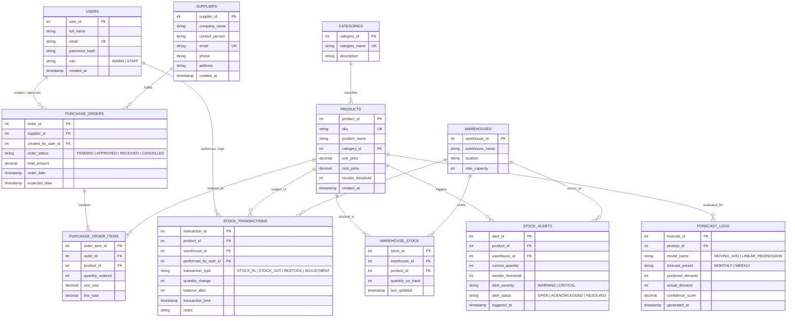

# Conceptual Entity-Relationship (ER) Diagram
## AI-Based Inventory Management System (AIMS) — DBMS Review 1

This document outlines the **Conceptual ER Modeling** for the AI-Based Inventory Management System. It articulates all core entities, their attributes (keys, descriptors, foreign links), relationship degrees, and mapping cardinalities.

---

## 1. Visual ER Diagram (Mermaid)

---

## 2. Entities & Attribute Specifications

### 2.1 Strong Entities
1. **`USERS`**: Staff and administrative accounts interacting with the dashboard and authorizing operations.
   - Key: `user_id` (PK)
   - Unique: `email`
2. **`CATEGORIES`**: Hierarchical grouping for inventory items (e.g., Electronics, Perishables, Raw Materials).
   - Key: `category_id` (PK)
   - Unique: `category_name`
3. **`SUPPLIERS`**: Vendors providing products for purchase orders.
   - Key: `supplier_id` (PK)
4. **`WAREHOUSES`**: Physical distribution centers or storage depots.
   - Key: `warehouse_id` (PK)
5. **`PRODUCTS`**: Catalog items tracked across warehouses.
   - Key: `product_id` (PK)
   - Unique: `sku` (Stock Keeping Unit)
   - Foreign Key: `category_id` references `CATEGORIES`

### 2.2 Associative & Dependent Entities
1. **`WAREHOUSE_STOCK`**: Resolves the $M:N$ relationship between `PRODUCTS` and `WAREHOUSES`.
   - Primary Key: `stock_id` (or composite `(warehouse_id, product_id)`)
   - Unique Constraint: `(warehouse_id, product_id)`
   - Attribute: `quantity_on_hand` with `CHECK (quantity_on_hand >= 0)`
2. **`PURCHASE_ORDERS`**: Header record for supplier procurement.
   - Foreign Keys: `supplier_id`, `created_by_user_id`
3. **`PURCHASE_ORDER_ITEMS`**: Line items for orders ($M:N$ resolution between `PURCHASE_ORDERS` and `PRODUCTS`).
   - Foreign Keys: `order_id`, `product_id`
4. **`STOCK_TRANSACTIONS`**: Immutable audit ledger recording every inventory delta (sales, restocks, damages).
   - Foreign Keys: `product_id`, `warehouse_id`, `performed_by_user_id`
5. **`STOCK_ALERTS`**: Auto-generated by database triggers when `quantity_on_hand <= reorder_threshold`.
   - Foreign Keys: `product_id`, `warehouse_id`
6. **`FORECAST_LOGS`**: Records AI/ML model demand forecasts alongside ground-truth actual demand for performance tracking.
   - Foreign Key: `product_id`

---

## 3. Relationship Cardinalities & Business Rules

| Relationship | Entities Involved | Cardinality | Business Semantics |
| :--- | :--- | :--- | :--- |
| **Categorization** | `CATEGORIES` $\rightarrow$ `PRODUCTS` | $1 : N$ (Mandatory 1 to Optional $N$) | A product belongs to exactly one category; a category can contain zero or more products. |
| **Multi-depot Stocking**| `PRODUCTS` $\leftrightarrow$ `WAREHOUSES` | $M : N$ (via `WAREHOUSE_STOCK`) | A product can be stocked in multiple warehouses; a warehouse holds multiple products. |
| **Procurement** | `SUPPLIERS` $\rightarrow$ `PURCHASE_ORDERS` | $1 : N$ | A supplier can receive multiple purchase orders; an order is issued to exactly one supplier. |
| **Order Line Items** | `PURCHASE_ORDERS` $\rightarrow$ `ITEMS` $\leftarrow$ `PRODUCTS` | $1 : N$ each | An order contains multiple items; each item specifies a product and ordered quantity. |
| **Audit Ledger** | `PRODUCTS` $\rightarrow$ `STOCK_TRANSACTIONS` | $1 : N$ | Every stock movement is immutably logged with before/after balance and user responsibility. |
| **Automated Alerts** | `PRODUCTS` $\rightarrow$ `STOCK_ALERTS` | $1 : N$ | Triggered automatically when warehouse stock breaches reorder thresholds. |
| **AI Demand Logs** | `PRODUCTS` $\rightarrow$ `FORECAST_LOGS` | $1 : N$ | Historical prediction runs logged for demand trend analysis. |
